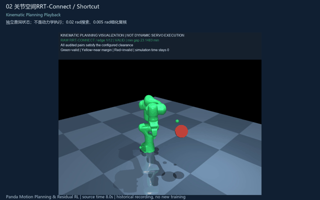
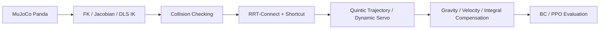
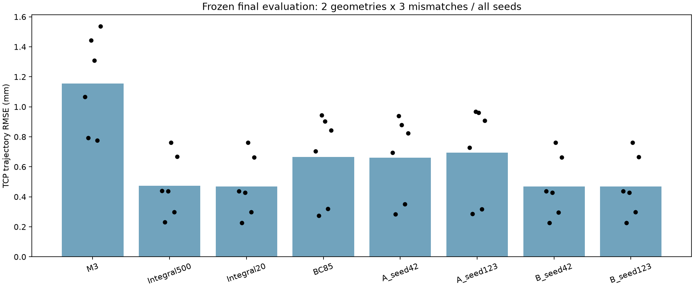

# Panda Motion Planning & Residual RL

**七自由度机械臂的运动规划与学习型控制系统**：从关节空间避障到真实MuJoCo动力学执行，再用强传统基线检验BC/PPO的实际价值。

[English](README_EN.md) · [轻量复现与大文件说明](docs/REPRODUCIBILITY.md) · [最终技术总结](docs/31_项目最终技术总结.md) · [验收与发布状态](docs/32_项目最终验收报告.md)



[▶ 80秒综合演示](assets/videos/project_overview.mp4) · [真实随机训练81.2秒](assets/videos/phase3dc_actual_training.mp4) · [八策略独立评价288秒](assets/videos/phase3dc_policy_comparison.mp4)

视频分别标记Kinematic Planning Playback、Dynamic Servo Execution、Actual PPO Training和Deterministic Policy Evaluation。机器人画面来自已有真实记录，未重新训练或生成确定性轨迹冒充随机探索；剪辑来源/时段/哈希见[视频清单](release/video_edit_manifest.json)。单条演示不作为总体成功率证据。



## 三项经验证的成果

1. 七维RRT-Connect与Shortcut，23个机器人碰撞几何、274个检查配对，搜索0.02 rad、独立复核0.005 rad；规划路径通过位置伺服与mj_step执行。
2. 受控实验揭示几何与动态裕度差异：原D路径规划最小5.756 mm，而真实执行降至约4.61–4.67 mm，触发原5 mm门槛。失败与受限保持记录保留。
3. 新最终测试的模型失配条件下，Integral20相对M3平均TCP轨迹RMSE低约59.3%。控制器、障碍物及安全标准保持一致。

## 冻结最终结果

两种新几何×三种失配，每方法6个完整任务，共48次评价。TCP误差覆盖trajectory+settle，成功要求稳定0.5秒并保持安全门槛。表格由原始tracking CSV重新计算；仓库提供[48份float64数值证据](release/final_cases.json)与原始CSV哈希，不筛除失败或较差种子。

| Method | TCP trajectory RMSE (mm) | Stable arrival | 5 mm violations / forbidden contacts |
|---|---:|---:|---:|
| M3 | 1.154319 | 6/6 | 0/0 |
| Integral500 | 0.472903 | 6/6 | 0/0 |
| Integral20 | 0.469299 | 6/6 | 0/0 |
| BC85 | 0.664839 | 6/6 | 0/0 |
| A_seed42 | 0.661844 | 6/6 | 0/0 |
| A_seed123 | 0.694725 | 6/6 | 0/0 |
| B_seed42 | 0.469134 | 6/6 | 0/0 |
| B_seed123 | 0.469692 | 6/6 | 0/0 |




**负结果同样保留：** BC85-PPO未稳定缩小专家差距；Integral20-PPO的两个种子变化很小且方向不一致。本有界Pilot未证明超越强积分基线的额外收益，不宣称统计显著、原创RL算法、Sim-to-Real或实机安全认证。

## 核心实现

- 真实关节ID/qpos地址、FK/Jacobian及DLS位置IK；七关节/XYZ键盘控制，软停止与限速home。
- 独立MjData碰撞查询；硬限位、自碰撞/相邻体过滤、外部障碍、地面与距离截断语义；保留离散漏检反例。
- 双树RRT、路径重建、碰撞检查Shortcut；五次时间缩放，无关节空间样条过冲。
- q_path、q_ref、ctrl、q_actual分开；500Hz物理及安全监控，20Hz七维受限学习动作。
- 名义补偿模型/扰动物理模型隔离；M3、受限积分、BC78/85、Tanh均值兼容的BC热启动PPO。
- 实际随机动作、合成/施加残差、奖励分量、每256决策更新与现场RGB关联，区别于独立评价。

## 安装与快速运行

测试环境：Windows / Python3.11、MuJoCo3.16.0；依赖固定在[requirements.txt](requirements.txt)。本次已在现有环境实际执行下列轻量入口；学习依赖沿用本机只读同版本回退路径的事实在doctor输出中公开，**没有宣称已在干净机器完成联网重装**。

```powershell
python scripts/setup_release.py --check
```

新环境安装模板及其验证范围见[复现说明](docs/REPRODUCIBILITY.md)。不要直接批量运行历史训练脚本。

```powershell
# Use an activated Python3.11 environment with the pinned dependencies.
python scripts/portfolio.py doctor
python scripts/portfolio.py model
python scripts/portfolio.py plan
python scripts/portfolio.py compare
python scripts/portfolio.py policy
python scripts/portfolio.py training-replay
python scripts/portfolio.py evaluate --compact
python scripts/portfolio.py metrics --compact
python -m pytest -q
```


`plan`只核对保存的路径；`compare`会新运行M3与Integral20两个真实动力学回合（写入被忽略的runtime目录），不会训练。`policy`校验六个checkpoint哈希并预测。`evaluate --compact`对冻结证据复算，并非新48次执行。需要单次独立策略执行可用 `python scripts/portfolio.py execute --method A_seed42`；仅做预检可加`--check`。

冻结协议的新动力学复执行另用`python scripts/portfolio.py evaluate --live --limit 1 --check`预检；移除`--check`才执行，`--limit`明确限制1～48。当前收尾只验证有限回合，没有重新运行完整48回合，更没有训练。

交互窗口可加`plan --viewer`或`training-replay --viewer`；原键盘控制入口为`python scripts/teleop_panda.py`。这些GUI变体本轮仅检查CLI/底层逻辑，未重新人工逐键验收。M切换模式后再用XYZ键，先聚焦窗口并切英文；详见历史教程05。

## 实际PPO训练记录

`training-replay`恢复仓库所带A_seed42首个真实训练回合的RGB和完整integration states，验证后退出；加`--viewer`用原观察器暂停/逐决策观看。旧观察器的`--mode evaluation`仍用旧78维环境，**不能直接加载本轮85维PPO**；使用本发布入口`execute`。

最后Pilot：A/B×seed42/123，各4096决策，总16384决策、447208次训练物理积分；64次PPO更新，所有完整回合和预算尾段分别记录。原222项测试的历史报告与发布副本轻量测试分别保存，不把前者冒充后者。

## 仓库结构与大文件

`src/`、`scripts/`保留完整核心与历史训练依赖；`tests/release/`为便携验收，`tests/historical/`保留原222项测试源码。`models/pretrained/`包含BC78/85及四个最终PPO，哈希见[模型清单](release/models.json)。历史其他checkpoint/完整训练数据留在本地研究归档，以[归档索引](release/original_archive_manifest.json)核对，未包含于Git，缺失时不能声称全历史复现。

原始48份CSV的gzip副本在本地但不进Git；已发布的数值投影没有量化误差，可重算本表。投影不是全部物理日志的替代品。输出、临时录像和本机诊断路径不进Git。

## 局限、来源与发布状态

少量几何/失配工况、两个训练种子、有限预算；未证明连续时间碰撞安全，仿真无接触不等于实机认证。没有动态障碍、全姿态规划或实机部署。

Panda模型来自MuJoCo Menagerie commit `cda5236f98383f6fbaa4820c6b18dba892cd087f`，对应目录Apache-2.0许可证和原来源说明原样保留，见[第三方声明](THIRD_PARTY_NOTICES.md)。依赖通过包管理安装，没有打包第三方库源码或FFmpeg二进制。

**新Panda仓库仅准备/发布为Private。** 公开权限与自有源码开源许可证待单独确认；此前Reacher的公开授权不适用于本项目。当前许可说明见[LICENSE.md](LICENSE.md)。
